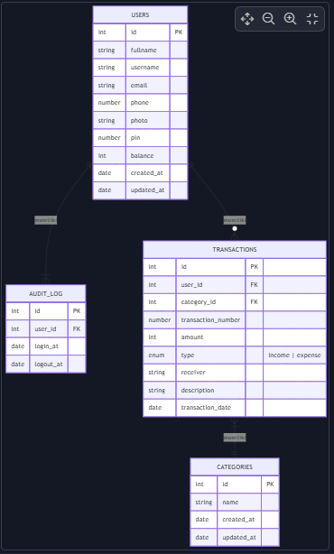
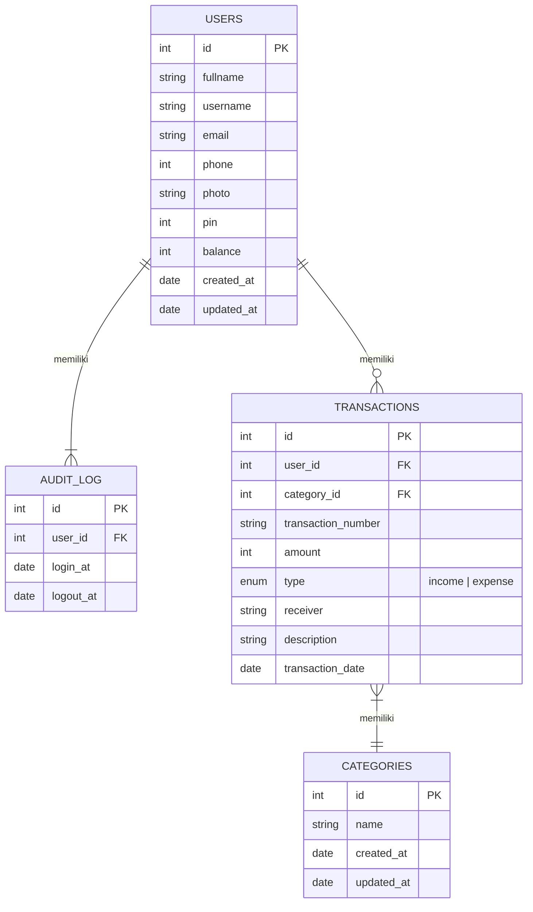

# Database E-Wallet (Week 3)

## ERD E-Wallet
### Screenshot ERD

### ERD (live mermaid)

## Urutan Eksekusi File Query SQL
1. DDL.sql
2. login.sql
3. register.sql
4. get_user_login_info.sql
5. get_check_user_pin.sql
6. get_transaction_history.sql
7. get_user_history.sql
8. get_user_account.sql
9. find_reciver.sql
10. create_transaction.sql
11. get_user_profile.sql
12. change_pin.sql
13. change_password.sql
14. change_user_profile.sql

### Keterangan
- Pastikan database-nya sudah dibuat terlebih dahulu
- Pastikan eksekusi file query-nya harus berurutan, dimulai dari DDL.sql (Data Defition Language), dst.